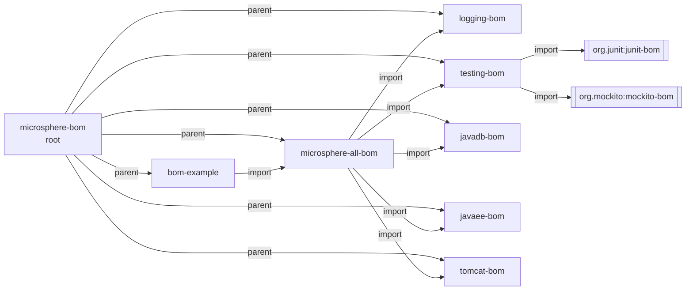
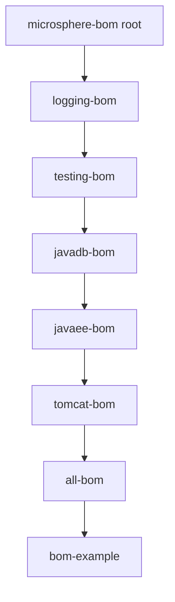
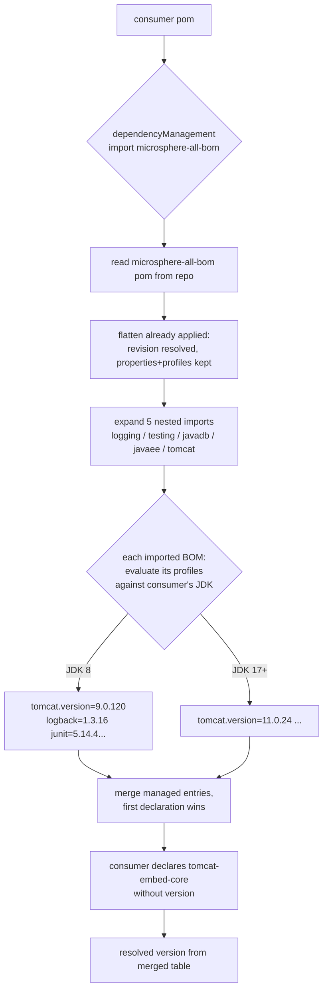
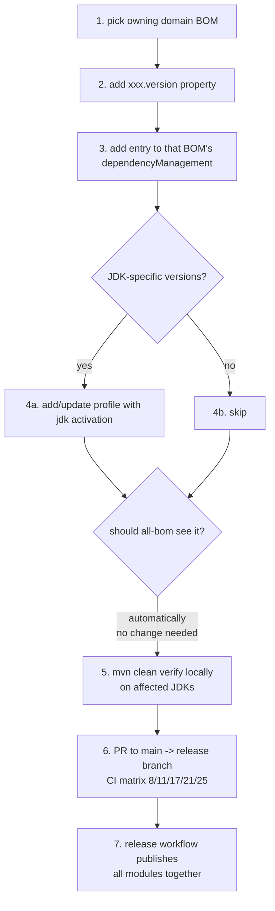

# Architecture

> Part of the [Microsphere BOM Developer Guide](README.md) · [中文文档](zh/architecture.md)

## 1. Design Goal

The project answers one question for the whole Microsphere ecosystem: **"which version of each third-party library
is known-good together, on each supported JDK?"** The answer is encoded declaratively in POM files only — no
version-forcing plugins, no runtime components.

## 2. Layered Architecture

Three layers, each with a distinct responsibility:

```mermaid
flowchart TB
    subgraph L0["Build Layer (external)"]
        P[microsphere-build<br/>parent POM: plugins, enforcer,<br/>flatten ${revision} handling, deploy]
    end
    subgraph L1["Aggregation Layer"]
        R[microsphere-bom<br/>root aggregator POM<br/>modules + revision]
        A[microsphere-all-bom<br/>aggregator BOM]
    end
    subgraph L2["Domain Layer (the actual contracts)"]
        L[microsphere-logging-bom]
        T[microsphere-testing-bom]
        D[microsphere-javadb-bom]
        E[microsphere-javaee-bom]
        C[microsphere-tomcat-bom]
    end
    subgraph L3["Validation Layer"]
        X[microsphere-bom-example<br/>jar + tests, deploy skipped]
    end
    P -.inherited by.-> R
    R -.parent of every module.-> L
    R -.parent.-> A
    A ==import scope==> L
    A ==import scope==> T
    A ==import scope==> D
    A ==import scope==> E
    A ==import scope==> C
    X ==import scope==> A
    T -.imports junit-bom / mockito-bom.-> TU[(upstream BOMs)]
```

- **Build layer**: everything about *how* artifacts are built/published lives in the external
  `microsphere-build` parent (see [build-system.md](build-system.md)).
- **Aggregation layer**: the root POM owns the reactor and the single `revision` property; `microsphere-all-bom`
  owns nothing but the five `import` entries.
- **Domain layer**: the only place where versions are declared. One BOM per technology domain, each independently
  importable.
- **Validation layer**: `microsphere-bom-example` consumes the aggregator exactly like a real downstream project,
  making the whole chain CI-verifiable.

## 3. Module Dependency Graph

Two kinds of edges must be distinguished — **parent** (build inheritance) and **import** (dependency management):



Note `microsphere-bom-example` has **no `<groupId>`** of its own — it inherits `io.github.microsphere-projects`
from the parent, a deliberate minimalism: every module is fully identified by `(parent, artifactId, ${revision})`.

## 4. Reactor Build Order

Maven computes the reactor from the `<modules>` list **plus** dependency ordering:



This equals the declaration order in the root `pom.xml` because each later module consumes earlier ones
(`all-bom` imports the five domain BOMs; `bom-example` imports `all-bom`). If a cycle-free graph is broken (e.g.
`bom-example` switched to import a domain BOM built *after* it), Maven would reorder automatically.

## 5. Version Resolution Flow (consumer side)

What happens when a downstream project imports `microsphere-all-bom` and declares `tomcat-embed-core` without a
version:



## 6. Design Patterns

| Pattern | Where | Notes |
|---------|-------|-------|
| **Bill of Materials (BOM)** | all five domain BOMs + `all-bom` | `pom` packaging + `dependencyManagement` only; consumed with `type=pom, scope=import` |
| **Nested BOM / BOM-of-BOMs** | `all-bom` imports domain BOMs; `testing-bom` imports `junit-bom`/`mockito-bom` | version authoring is pushed to the lowest BOM that knows best |
| **Aggregator (reactor) POM** | root `microsphere-bom` | `<modules>` only; also the parent of all modules ("symmetric aggregation") |
| **Property indirection** | `<slf4j.version>` etc. | one edit point per library; naming convention `artifact.version` (`.<version>` suffix) |
| **Profile-based environment activation** | logging / testing / javadb / tomcat | `<activation><jdk>` ranges select JDK-compatible fallbacks |
| **CI-friendly `${revision}` + flatten** | root property, every `<version>` field | single version source; flatten (resolveCiFriendliesOnly) makes published POMs self-contained |
| **First-declaration-wins** | every `dependencyManagement` | governs conflict between nested imports and consumer overrides |
| **Validation module / canary** | `microsphere-bom-example` | version-free dependency + real tests = executable proof of the contract; deploy skipped since it publishes nothing |

## Adding a Managed Dependency

The complete contribution loop:



Rules behind the steps:

1. Versions live **only** in domain BOMs — never in `all-bom` or the root POM.
2. A new library that fits an existing domain needs **one file changed**; a new domain needs a new BOM module
   **plus** one `import` entry in `all-bom` **plus** one `<module>` in the root POM.
3. `microsphere-bom-example` is extended whenever you want a new coordinate to be *compile-tested* in CI.

## 7. Source Statistics (release branch)

| Module | LOC (pom) | Managed coordinates | Profiles |
|--------|-----------|----------------------|----------|
| root `microsphere-bom` | ~69 | 0 (aggregator) | 0 |
| `microsphere-logging-bom` | ~110 | 8 | 1 auto (`java8-10`) |
| `microsphere-testing-bom` | ~110 | 5 + 2 nested BOM families | 1 auto (`java8-16`) |
| `microsphere-javadb-bom` | ~65 | 2 | 1 auto (`java8`) |
| `microsphere-javaee-bom` | ~290 | 31 | 0 |
| `microsphere-tomcat-bom` | ~230 | 25 (+1 conditional) | 3 auto + 2 manual |
| `microsphere-all-bom` | ~90 | 5 imports | 0 |
| `microsphere-bom-example` | ~55 | consumer only | 0 |

## See Also

- [build-system.md](build-system.md) — `${revision}`, flatten and profile mechanics
- [ci-cd.md](ci-cd.md) — build matrix and release pipeline
- Per-module deep dives: [logging](logging-bom.md) · [testing](testing-bom.md) · [javadb](javadb-bom.md) ·
  [javaee](javaee-bom.md) · [tomcat](tomcat-bom.md)
