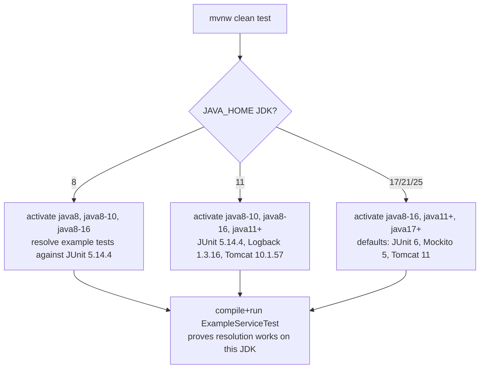

# Build System

> Part of the [Microsphere BOM Developer Guide](README.md) · [中文文档](zh/build-system.md)

## 1. Build Stack Overview

| Concern | Mechanism |
|---------|-----------|
| Multi-module coordination | root aggregator `microsphere-bom` (`packaging=pom`, `<modules>`) |
| Versioning | ci-friendly `${revision}` property + flatten-maven-plugin |
| Plugin/quality configuration | inherited from external parent `io.github.microsphere-projects:microsphere-build` |
| Wrapper | Maven Wrapper `mvnw` / `mvnw.cmd` (no local Maven install required) |
| Verification | `microsphere-bom-example` resolves version-free deps and runs tests per JDK |

## 2. `${revision}` — Single Version Source

The root POM defines the **only** version literal:

```xml
<properties>
    <revision>0.3.17-SNAPSHOT</revision>
</properties>
```

Every module (and every inter-module `<dependency>`/`<parent>` reference) writes `${revision}`. Benefits:

- One edit per release; no cross-module version skew is expressible.
- Overridable at build time: `./mvnw clean test -Drevision=0.0.1-SNAPSHOT` builds the whole tree under a scratch
  version without touching files (CI does exactly this — see [ci-cd.md](ci-cd.md)).

### Flatten: making `${revision}` publishable

Maven would otherwise publish POMs containing the literal `${revision}`, which is unresolvable downstream. The
parent configures flatten-maven-plugin (versions read from `microsphere-build` 0.3.17):

| Setting | Value | Effect |
|---------|-------|--------|
| `flatten.mode` | `resolveCiFriendliesOnly` | replaces only `${revision}`/`${sha1}`/`${changelist}` in the published POM |
| `flatten.pomElements.properties` | `keep` | **`<properties>` survive** — consumers still see `slf4j.version=…` etc. |
| `flatten.pomElements.parent` | `expand` | parent coordinates are written out concretely |
| `flatten.pomElements.dependencyManagement` | `interpolate` | managed versions are interpolated where possible |

Consequence for the JDK profiles: since profiles are **not** flattened away, an importing project re-evaluates
them against **its own** JDK. This is the mechanism behind the per-JDK tables in
[../user-guide/versions.md](../user-guide/versions.md).

```mermaid
sequenceDiagram
    participant Dev as Developer/CI
    participant Reactor as Maven Reactor
    participant Flatten as flatten-maven-plugin
    participant Central as Maven Central
    participant Cons as Consumer build

    Dev->>Reactor: mvn deploy -Drevision=0.3.16
    Reactor->>Flatten: generate .flattened-pom.xml per module
    Flatten-->>Reactor: POM with ${revision}→0.3.16, properties+profiles kept
    Reactor->>Central: publish 7 POMs (root + 5 domain BOMs + all-bom); example deploy skipped
    Cons->>Central: import microsphere-all-bom:0.3.16
    Cons->>Cons: expand nested imports, activate profiles on consumer JDK
```

## 3. The `microsphere-build` Parent

All build logic (compiler, surefire, enforcer, javadoc/source jars, signing, Central publishing, toolchains) lives
in the external parent, currently `microsphere-build:0.3.x` aligned with this project's line. Root POM keeps zero
`<build>` section of its own — pure aggregation. When the parent bumps, `microsphere-bom` picks up plugin upgrades
without POM edits here.

## 4. Profile Activation Semantics (build-time)

- JDK activation reads the JVM running Maven (`java.version` at model-building time) — **not** `-Djava.version`
  (which the parent uses for compiler source/target, a separate concern).
- Activation happens in the *consuming* model; therefore locally running `./mvnw clean test` on JDK 8 executes the
  fallback branches (JUnit 5.14.4 etc.) exactly as a consumer on JDK 8 would.



## 5. Common Commands

```bash
./mvnw clean verify                     # whole reactor, current JDK
./mvnw clean test -pl microsphere-testing-bom      # single module
./mvnw clean install -DskipTests        # local repo install (e.g. for downstream testing)
./mvnw help:effective-pom -pl microsphere-all-bom   # inspect merged model
./mvnw dependency:tree -pl microsphere-bom-example  # see resolved versions of the validation module
```

`microsphere-bom-example/.flattened-pom.xml` (build output) is handy to see exactly what the flatten step emits.

## 6. Constraints & Gotchas

1. **Never** hard-code a module version in a child POM — `${revision}` or parent-inherited only.
2. Changing `revision` requires a full-reactor build; a stale single-module install can mask version mismatches.
3. The example module is deployed nowhere (`maven-deploy-plugin` `<skip>true</skip>`): publishing covers root +
   5 domain BOMs + all-bom — 7 of the 8 reactor entries.
4. Windows developers: use `mvnw.cmd`; the shell scripts are POSIX (`bash`).

## See Also

- [ci-cd.md](ci-cd.md) — how CI drives the above
- [architecture.md](architecture.md) — module graph
