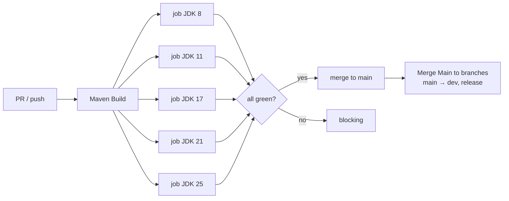
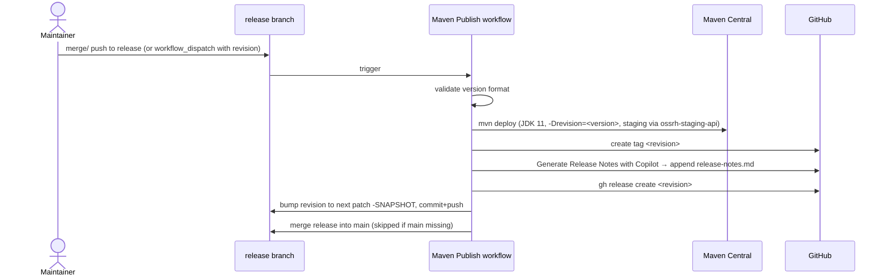

# CI / CD

> Part of the [Microsphere BOM Developer Guide](README.md) · [中文文档](zh/ci-cd.md)

All automation lives in `.github/workflows/` (six files). Branch model: `dev` → `main` → (`release` is the
publish branch; `release-1.x` would be its historical sibling but does not exist).

## 1. Workflow Inventory

| Workflow | File | Triggers | Purpose |
|----------|------|----------|---------|
| Maven Build | `maven-build.yml` | push/PR to `main`/`dev`; PR to `release` | compile + run tests across JDK matrix **8, 11, 17, 21, 25** (Temurin), `-Drevision=0.0.1-SNAPSHOT` |
| Maven Publish | `maven-publish.yml` | push to `release`, or manual with `revision` input | deploy to Maven Central, tag, GitHub Release, auto-bump, merge back |
| Generate Release Notes | `generate-release-notes.yml` | push to `release`, manual | Copilot-written notes appended to `release-notes.md` |
| List BOM Dependencies | `list-bom-dependencies.yml` | push/PR + `release: published` + manual | parse each domain BOM → dependency table in job summary; update *BOM-Dependencies* wiki page on releases (excludes `all-bom` and `bom-example`) |
| Merge Main to branches | `merge-main-to-branches.yml` | push to `main` | auto-merge `main` → `dev` and `main` → `release` |
| Sync Branches from Upstream | `sync-branches-from-upstream.yml` | schedule `*/5 * * * *`, push | fork maintenance only — exits immediately when repo is the upstream itself |

## 2. Build Pipeline

Every matrix leg executes the full reactor, i.e. on JDK 8 the `java8-*` fallback branches of the BOMs are what CI
actually resolves and tests — the per-JDK tables in the User Guide are machine-verified, not aspirational.

## 3. Release Pipeline (`maven-publish.yml`)

Observable traces of this flow in history: commits like `chore: bump version to next patch after publishing
0.3.16` and `chore: merge release into main [skip ci]`, with tags `0.3.15`, `0.3.16`, … one per patch.

## 4. Version Bump & Maintenance Loops

- **Dependabot** (config `.github/dependabot.yml`) opens PRs like *"Build(deps): Bump tomcat.version from 11.0.26
  to 11.0.27"* against `main`; merge → auto-merged down to `release` → next publish cut.
- Because one property can drive 20+ coordinates (tomcat) or a nested BOM (junit/mockito), a bump PR must update
  **base property and every profile override for the same line** — see
  [tomcat-bom.md](tomcat-bom.md#5-version-skew-between-base-and-profile).
- `list-bom-dependencies.yml` keeps the wiki's BOM-Dependencies page in sync with each published version, giving
  consumers a per-release snapshot of every managed coordinate.

## 5. Permissions & Hygiene

- All workflows declare least-privilege `permissions` (`contents: read` for builds; `contents: write` only where
  commits/releases are produced; `models: read` for Copilot notes).
- Cross-branch merges use `github-actions[bot]` identity and `[skip ci]` markers to avoid trigger loops.
- `sync-branches-from-upstream.yml` is template-derived for this ecosystem: harmless in the upstream repo, useful
  in forks.

## See Also

- [build-system.md](build-system.md) — what the CI is actually driving
- [architecture.md](architecture.md) — module graph
