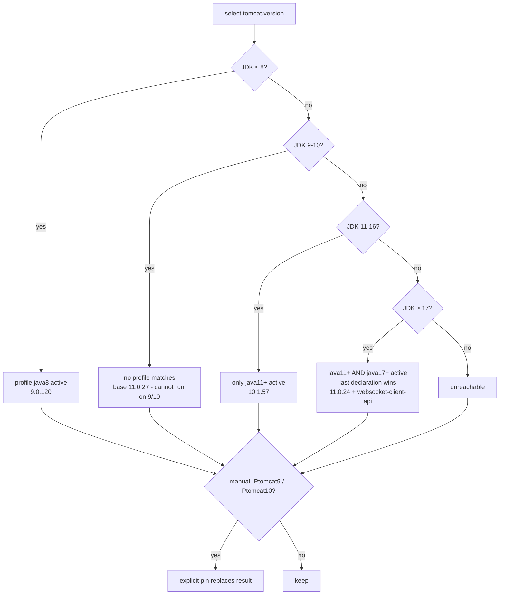

# microsphere-tomcat-bom — Source Analysis

> Part of the [Microsphere BOM Developer Guide](README.md) · [中文文档](zh/tomcat-bom.md)

Module source: [`microsphere-tomcat-bom/pom.xml`](../../../microsphere-tomcat-bom/pom.xml)

## 1. POM Skeleton

The most profile-heavy module: one property governs 25 coordinates, five profiles shape that property, and one
profile adds a coordinate.

```
<properties>  tomcat.version=11.0.27
<dependencyManagement>
    org.apache.tomcat.embed  × 4   (core, jasper, el, websocket)
    org.apache.tomcat        × 21  (catalina, coyote, jasper, jdbc, tribes, util, …)
<profiles>
    java8     (auto) → 9.0.120
    java11+   (auto) → 10.1.57
    java17+   (auto) → 11.0.24  + extra managed coordinate tomcat-websocket-client-api
    tomcat9   (manual) → 9.0.120
    tomcat10  (manual) → 10.1.57
```

## 2. Single-Knob Design

Every Tomcat artifact — embed and full alike — is `${tomcat.version}`. Tomcat ships *all* modules from one
tagged source tree at one version, so a per-artifact knob would only create skew bugs. The flip side: **any** JDK
or manual profile switch moves the entire stack at once, which is exactly what the `javax→jakarta` namespace
boundary demands (9.0 vs 10.1/11 cannot be mixed).

## 3. Profile Interaction — the Tricky Part

`java11+` (`[11,)`) and `java17+` (`[17,)`) **both activate** on JDK ≥ 17, and both define `tomcat.version`. Maven
applies active profile *definitions* in POM declaration order — the **last declared wins** — and `java17+` is
declared after `java11+`, so JDK 17 resolves to 11.0.24, not 10.1.57.



> ⚠️ Maintenance rule: reordering the `<profiles>` block silently changes resolution on JDK ≥ 17. Keep the
> ascending-band ordering (java8 → java11+ → java17+) and review profile moves in code review as behavior changes.

Note the *other* precedence rule: this "last-declared-active-profile wins" applies **between profiles overriding
the same property**, while `dependencyManagement` merging still follows "first declaration wins". The two rules
operate on different objects (property definitions vs dependency entries) and do not conflict.

## 4. The Conditional Coordinate

`tomcat-websocket-client-api` exists only in the `java17+` profile's own `<dependencyManagement>`:

- On Tomcat 11 (JDK 17+) the client API is a first-class module; on 9.0/10.1 lines it does not exist, so declaring
  it globally would create a unresolvable managed entry the moment the JDK fallback selected 9.x.
- This is the one place in the repository where a profile adds a **coordinate** rather than overriding a property —
  the escape hatch for "artifact only exists on this line".

## 5. Version Skew Between Base and Profile

Base is 11.0.**27** while `java17+` pins 11.0.**24** — Dependabot bumps the base property (and 9.0.120/10.1.57
inside their profiles) in separate PRs; they drift by design between releases. When triaging a bump PR, update all
four occurrences of a line (base + profiles) or the profiles will serve stale patches.

## 6. Relationship to Other Modules

- Users pairing with [javaee-bom](javaee-bom.md) (`javax.servlet`) must force `-Ptomcat9` — Tomcat 10.1+ switched
  to `jakarta.*`. The default resolution on JDK 8 already produces 9.0.120, so the pairing works naturally there.
- `tomcat-embed-core` transitively pulls the matching servlet API **from Tomcat's own jars**, so consumers on
  10.1/11 don't import `javax.servlet-api` at all.

## See Also

- User contract & compatibility table: [../user-guide/tomcat-bom.md](../user-guide/tomcat-bom.md)
- Profile mechanics at the build level: [build-system.md](build-system.md)
