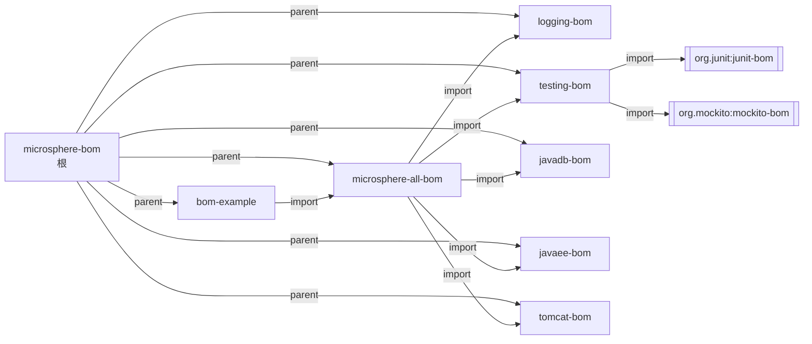
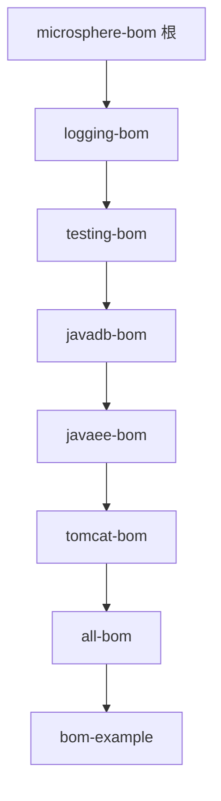
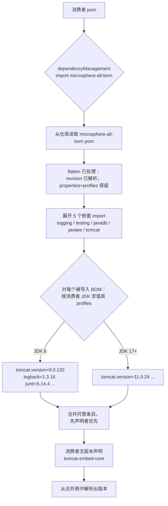
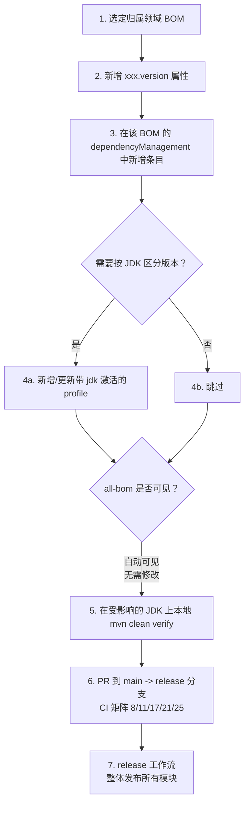

# 架构设计

> 本文属于 [Microsphere BOM 开发者文档](README.md) · 英文版见 [../architecture.md](../architecture.md)

## 1. 设计目标

本项目为整个 Microsphere 生态回答一个问题：**"在每个受支持的 JDK 上，各第三方库的哪个版本是彼此兼容、经过验证的？"**
答案完全以声明式方式编码在 POM 文件中 —— 没有强制版本的插件，也没有运行期组件。

## 2. 分层架构

三层结构，各司其职：

```mermaid
flowchart TB
    subgraph L0["构建层（外部）"]
        P[microsphere-build<br/>父 POM：插件、enforcer、<br/>flatten ${revision} 处理、发布]
    end
    subgraph L1["聚合层"]
        R[microsphere-bom<br/>根聚合 POM<br/>modules + revision]
        A[microsphere-all-bom<br/>聚合 BOM]
    end
    subgraph L2["领域层（真正的契约）"]
        L[microsphere-logging-bom]
        T[microsphere-testing-bom]
        D[microsphere-javadb-bom]
        E[microsphere-javaee-bom]
        C[microsphere-tomcat-bom]
    end
    subgraph L3["校验层"]
        X[microsphere-bom-example<br/>jar + 测试，跳过 deploy]
    end
    P -.被继承.-> R
    R -.每个模块的 parent.-> L
    R -.parent.-> A
    A ==import scope==> L
    A ==import scope==> T
    A ==import scope==> D
    A ==import scope==> E
    A ==import scope==> C
    X ==import scope==> A
    T -.导入 junit-bom / mockito-bom.-> TU[(上游 BOM)]
```

- **构建层**：*如何*构建与发布的一切都在外部父工程 `microsphere-build` 中（见 [build-system.md](build-system.md)）。
- **聚合层**：根 POM 持有 reactor 与唯一的 `revision` 属性；`microsphere-all-bom` 除了五条 `import` 什么都不拥有。
- **领域层**：唯一声明版本的地方。每个技术领域一个 BOM，均可独立导入。
- **校验层**：`microsphere-bom-example` 像真实下游项目一样消费聚合 BOM，使整条链路可被 CI 验证。

## 3. 模块依赖关系图

必须区分两类边 —— **parent**（构建继承）与 **import**（依赖管理）：



注意 `microsphere-bom-example` 刻意**不写自己的 `<groupId>`** —— 从父级继承
`io.github.microsphere-projects`。这是有意的极简风格：每个模块由 `(parent, artifactId, ${revision})` 完整标识。

## 4. Reactor 构建顺序

Maven 依据 `<modules>` 列表**加上**依赖关系计算 reactor：



该顺序与根 `pom.xml` 的声明顺序一致，因为靠后的模块消费靠前的模块（`all-bom` 导入五个领域 BOM；
`bom-example` 导入 `all-bom`）。若依赖关系改变（例如 `bom-example` 改为导入某个排在其后的领域 BOM），Maven 会自动重排。

## 5. 版本决议流程（消费者侧）

下游项目导入 `microsphere-all-bom` 并不写版本地声明 `tomcat-embed-core` 时发生的事：



## 6. 设计模式

| 模式 | 位置 | 说明 |
|------|------|------|
| **Bill of Materials（BOM）** | 五个领域 BOM + `all-bom` | `pom` 打包 + 仅 `dependencyManagement`；以 `type=pom, scope=import` 消费 |
| **嵌套 BOM / BOM of BOMs** | `all-bom` 导入领域 BOM；`testing-bom` 导入 `junit-bom`/`mockito-bom` | 版本编写权下放到"最懂"的那层 BOM |
| **Aggregator（reactor）POM** | 根 `microsphere-bom` | 只有 `<modules>`；同时是所有模块的 parent（对称聚合） |
| **属性间接化** | `<slf4j.version>` 等 | 每个库一个修改点；命名约定 `artifact.version`（`.<version>` 后缀） |
| **基于 profile 的环境激活** | logging / testing / javadb / tomcat | `<activation><jdk>` 范围选择 JDK 兼容的回退版本 |
| **ci-friendly `${revision}` + flatten** | 根属性与所有 `<version>` 字段 | 单一版本源；flatten（resolveCiFriendliesOnly）让发布的 POM 自包含 |
| **先声明者优先** | 所有 `dependencyManagement` | 支配嵌套 import 与消费者覆盖之间的冲突 |
| **校验模块 / 金丝雀** | `microsphere-bom-example` | 无版本依赖 + 真实测试 = 契约的可执行证明；不发布故跳过 deploy |

## Adding a Managed Dependency

完整贡献闭环：



步骤背后的规则：

1. 版本**只**存在于领域 BOM —— `all-bom` 与根 POM 中永不出现版本声明。
2. 新库若归属既有领域，**只需改一个文件**；新领域则需新增 BOM 模块，**并在** `all-bom` 加一条 `import`、在根 POM 加一个 `<module>`。
3. 希望某个新坐标在 CI 中被*编译级验证*时，扩充 `microsphere-bom-example`。

## 7. 源码统计（release 分支）

| 模块 | 行数（pom） | 托管坐标数 | Profiles |
|------|-------------|------------|----------|
| 根 `microsphere-bom` | ~69 | 0（聚合器） | 0 |
| `microsphere-logging-bom` | ~110 | 8 | 1 自动（`java8-10`） |
| `microsphere-testing-bom` | ~110 | 5 + 2 个嵌套 BOM 制品族 | 1 自动（`java8-16`） |
| `microsphere-javadb-bom` | ~65 | 2 | 1 自动（`java8`） |
| `microsphere-javaee-bom` | ~290 | 31 | 0 |
| `microsphere-tomcat-bom` | ~230 | 25（+1 条件条目） | 3 自动 + 2 手动 |
| `microsphere-all-bom` | ~90 | 5 条 import | 0 |
| `microsphere-bom-example` | ~55 | 仅消费者 | 0 |

## 相关文档

- [build-system.md](build-system.md) —— `${revision}`、flatten 与 profile 机制
- [ci-cd.md](ci-cd.md) —— 构建矩阵与发布流水线
- 各模块深入分析：[logging](logging-bom.md) · [testing](testing-bom.md) · [javadb](javadb-bom.md) ·
  [javaee](javaee-bom.md) · [tomcat](tomcat-bom.md)
