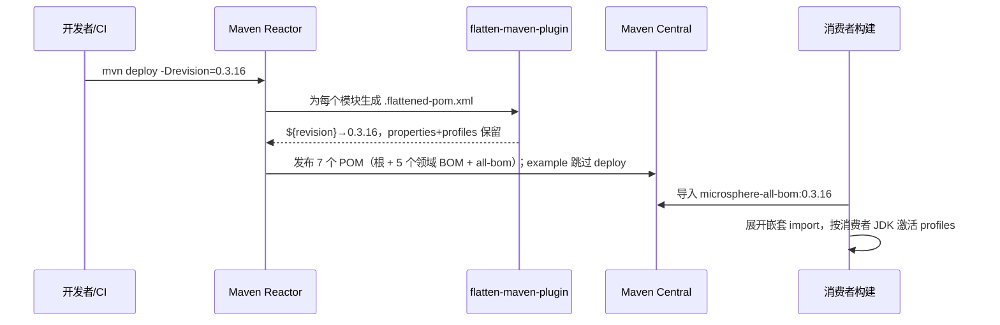
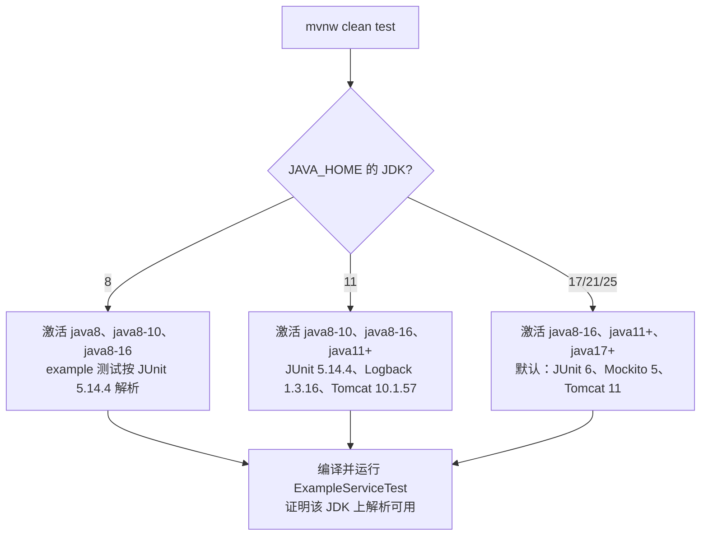

# 构建系统

> 本文属于 [Microsphere BOM 开发者文档](README.md) · 英文版见 [../build-system.md](../build-system.md)

## 1. 构建栈总览

| 关注点 | 机制 |
|--------|------|
| 多模块协同 | 根聚合 POM `microsphere-bom`（`packaging=pom`、`<modules>`） |
| 版本管理 | ci-friendly `${revision}` 属性 + flatten-maven-plugin |
| 插件/质量配置 | 全部继承自外部父工程 `io.github.microsphere-projects:microsphere-build` |
| Wrapper | Maven Wrapper `mvnw` / `mvnw.cmd`（无需本机安装 Maven） |
| 验证 | `microsphere-bom-example` 以无版本方式解析依赖并按 JDK 运行测试 |

## 2. `${revision}` —— 单一版本源

根 POM 定义**唯一**的版本字面量：

```xml
<properties>
    <revision>0.3.17-SNAPSHOT</revision>
</properties>
```

每个模块（以及模块间的每个 `<dependency>`/`<parent>` 引用）都写 `${revision}`。收益：

- 每次发布只改一处；跨模块版本错配在语法层面就不可能表达。
- 构建期可覆盖：`./mvnw clean test -Drevision=0.0.1-SNAPSHOT` 用临时版本构建整棵树而不动任何文件
（CI 正是这么做的 —— 见 [ci-cd.md](ci-cd.md)）。

### flatten：让 `${revision}` 可发布

否则 Maven 会把含 `${revision}` 字面量的 POM 发布出去，下游无法解析。父工程配置了 flatten-maven-plugin
（取值读自 `microsphere-build` 0.3.17）：

| 配置 | 值 | 效果 |
|------|-----|------|
| `flatten.mode` | `resolveCiFriendliesOnly` | 发布 POM 中仅替换 `${revision}`/`${sha1}`/`${changelist}` |
| `flatten.pomElements.properties` | `keep` | **`<properties>` 保留** —— 消费者仍能看到 `slf4j.version=…` 等 |
| `flatten.pomElements.parent` | `expand` | parent 坐标被具体化写出 |
| `flatten.pomElements.dependencyManagement` | `interpolate` | 托管版本尽可能内插 |

对 JDK profile 的影响：profile **不会**被 flatten 抹掉，导入方项目会按**自己的 JDK** 重新求值它们。这正是用户文档
[../user-guide/zh/versions.md](../../user-guide/zh/versions.md) 中"按 JDK 有效版本"表的机制。



## 3. 父工程 `microsphere-build`

全部构建逻辑（compiler、surefire、enforcer、javadoc/source jar、签名、Central 发布、toolchains）都在外部父工程中，
当前与本版本线对齐为 `microsphere-build:0.3.x`。根 POM 自身没有任何 `<build>` 段 —— 纯聚合。父工程升版时，
`microsphere-bom` 无需修改本地 POM 即获得插件升级。

## 4. Profile 激活语义（构建期）

- JDK 激活读取的是运行 Maven 的 JVM（模型构建期的 `java.version`）—— **不是** `-Djava.version`
（后者由父工程用于编译 source/target，是另一回事）。
- 激活发生在*消费方*模型中；因此在 JDK 8 上本地运行 `./mvnw clean test` 会执行与 JDK 8 消费者完全相同的回退分支
（JUnit 5.14.4 等）。



## 5. 常用命令

```bash
./mvnw clean verify                     # 整个 reactor，当前 JDK
./mvnw clean test -pl microsphere-testing-bom      # 单模块
./mvnw clean install -DskipTests        # 安装到本地仓库（供下游测试）
./mvnw help:effective-pom -pl microsphere-all-bom   # 查看合并后的模型
./mvnw dependency:tree -pl microsphere-bom-example  # 查看校验模块解析出的版本
```

`microsphere-bom-example/.flattened-pom.xml`（构建产物）可直观看到 flatten 步骤的确切输出。

## 6. 约束与坑

1. **永远不要**在子 POM 里硬编码模块版本 —— 只能用 `${revision}` 或继承父级。
2. 修改 `revision` 后需全 reactor 构建；陈旧的单模块 install 可能掩盖版本错配。
3. example 模块不发布到任何仓库（`maven-deploy-plugin` `<skip>true</skip>`）：发布覆盖根 + 5 个领域 BOM +
   all-bom 共 7 个条目（reactor 共 8 个模块）。
4. Windows 开发者：使用 `mvnw.cmd`；shell 脚本仅限 POSIX（`bash`）。

## 相关文档

- [ci-cd.md](ci-cd.md) —— CI 如何驱动上述机制
- [architecture.md](architecture.md) —— 模块图
