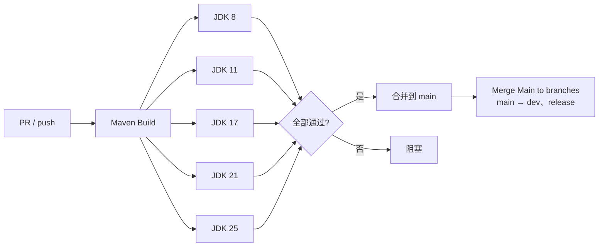
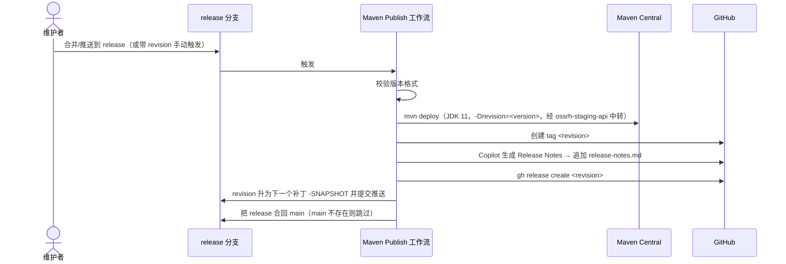

# CI / CD

> 本文属于 [Microsphere BOM 开发者文档](README.md) · 英文版见 [../ci-cd.md](../ci-cd.md)

全部自动化位于 `.github/workflows/`（共六个文件）。分支模型：`dev` → `main` →（`release` 是发布分支；
`release-1.x` 本应是其历史姊妹分支，但并不存在）。

## 1. 工作流清单

| 工作流 | 文件 | 触发条件 | 用途 |
|--------|------|----------|------|
| Maven Build | `maven-build.yml` | push/PR 到 `main`/`dev`；PR 到 `release` | JDK 矩阵 **8、11、17、21、25**（Temurin）编译+测试，`-Drevision=0.0.1-SNAPSHOT` |
| Maven Publish | `maven-publish.yml` | push 到 `release`，或携带 `revision` 输入手动触发 | 发布到 Maven Central、打 tag、建 GitHub Release、自动升版、回合并分支 |
| Generate Release Notes | `generate-release-notes.yml` | push 到 `release`、手动 | 由 Copilot 撰写并追加到 `release-notes.md` |
| List BOM Dependencies | `list-bom-dependencies.yml` | push/PR + `release: published` + 手动 | 解析各领域 BOM → Job Summary 依赖表；发布时更新 wiki 的 BOM-Dependencies 页（排除 `all-bom` 与 `bom-example`） |
| Merge Main to branches | `merge-main-to-branches.yml` | push 到 `main` | 自动把 `main` 合入 `dev` 与 `release` |
| Sync Branches from Upstream | `sync-branches-from-upstream.yml` | 定时 `*/5 * * * *`、push | 仅用于 fork 维护 —— 在上游仓库中立即退出 |

## 2. 构建流水线

矩阵的每一条都执行完整 reactor：在 JDK 8 上，CI 实际解析并测试的正是 BOM 的 `java8-*` 回退分支 —— 用户文档中的
按 JDK 版本表是机器验证过的，不是愿望清单。

## 3. 发布流水线（`maven-publish.yml`）

历史提交中可见该流程的痕迹：如 `chore: bump version to next patch after publishing 0.3.16` 与
`chore: merge release into main [skip ci]`，以及每个补丁对应一个的 tag `0.3.15`、`0.3.16`……

## 4. 版本升级与维护循环

- **Dependabot**（配置在 `.github/dependabot.yml`）针对 `main` 开 PR，如
  *"Build(deps): Bump tomcat.version from 11.0.26 to 11.0.27"*；合并 → 自动下沉到 `release` → 等待下次发布。
- 一个属性可驱动 20+ 坐标（tomcat）或一个嵌套 BOM（junit/mockito），因此升级 PR 必须同时更新**基础属性与同一
  版本线在各 profile 中的覆盖** —— 见 [tomcat-bom.md](tomcat-bom.md#5-基础值与-profile-之间的版本漂移)。
- `list-bom-dependencies.yml` 让 wiki 的 BOM-Dependencies 页与每个发布版本保持同步，为消费者提供每个版本全部
  托管坐标的快照。

## 5. 权限与卫生

- 所有工作流声明最小权限 `permissions`（构建仅 `contents: read`；产生提交/发布的才 `contents: write`；
  Copilot 撰写 notes 用 `models: read`）。
- 跨分支合并使用 `github-actions[bot]` 身份并带 `[skip ci]` 标记，避免触发循环。
- `sync-branches-from-upstream.yml` 是整个生态的模板产物：在上游仓库无害，在 fork 中才发挥作用。

## 相关文档

- [build-system.md](build-system.md) —— CI 驱动的底层机制
- [architecture.md](architecture.md) —— 模块图
