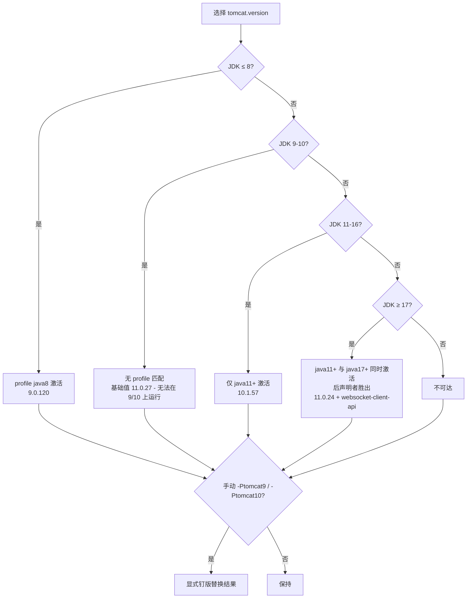

# microsphere-tomcat-bom — 源码分析

> 本文属于 [Microsphere BOM 开发者文档](README.md) · 英文版见 [../tomcat-bom.md](../tomcat-bom.md)

模块源码：[`microsphere-tomcat-bom/pom.xml`](../../../../microsphere-tomcat-bom/pom.xml)

## 1. POM 骨架

profile 最复杂的模块：一个属性统治 25 个坐标，五个 profile 塑造该属性，其中一个 profile 还追加坐标。

```
<properties>  tomcat.version=11.0.27
<dependencyManagement>
    org.apache.tomcat.embed  × 4   （core、jasper、el、websocket）
    org.apache.tomcat        × 21  （catalina、coyote、jasper、jdbc、tribes、util……）
<profiles>
    java8     （自动）→ 9.0.120
    java11+   （自动）→ 10.1.57
    java17+   （自动）→ 11.0.24 + 追加固化条目 tomcat-websocket-client-api
    tomcat9   （手动）→ 9.0.120
    tomcat10  （手动）→ 10.1.57
```

## 2. 单旋钮设计

所有 Tomcat 制品（embed 与完整模块一视同仁）都是 `${tomcat.version}`。Tomcat 的*全部*模块出自同一 tag 的源码树、
以同一版本发布，逐制品设旋钮只会制造错配 bug。另一面：任何 JDK 或手动 profile 切换都会*整体*移动整个技术栈 ——
这正是 `javax→jakarta` 命名空间边界所要求的（9.0 与 10.1/11 不可混用）。

## 3. Profile 交互 —— 最微妙的部分

`java11+`（`[11,)`）与 `java17+`（`[17,)`）在 JDK ≥ 17 上**同时激活**，且都定义 `tomcat.version`。Maven 按 POM 中
的**声明顺序**应用激活 profile 的定义 —— **后声明者胜出** —— `java17+` 声明在 `java11+` 之后，故 JDK 17 解析为
11.0.24 而非 10.1.57。



> ⚠️ 维护规则：重排 `<profiles>` 块会*悄然改变* JDK ≥ 17 的解析结果。请保持升序区间排列
>（java8 → java11+ → java17+），并把 profile 位置调整当作行为变更进行评审。

注意*另一条*优先级规则：上述"后声明的激活 profile 胜出"适用于**profile 之间覆盖同名属性**；而
`dependencyManagement` 合并遵循"先声明者优先"。两条规则作用对象不同（属性定义 vs 依赖条目），并不冲突。

## 4. 条件坐标

`tomcat-websocket-client-api` 只存在于 `java17+` profile 自己的 `<dependencyManagement>` 中：

- Tomcat 11（JDK 17+）上 client API 是一等模块；9.0/10.1 线上该制品不存在，若全局声明，一旦 JDK 回退选中 9.x
  就会留下无法解析的托管条目。
- 这是全仓库唯一一处 profile 追加**坐标**（而非覆盖属性）的地方 —— "制品仅存在于某条版本线"时的逃生舱。

## 5. 基础值与 profile 之间的版本漂移

基础值是 11.0.**27**，而 `java17+` 钉在 11.0.**24** —— Dependabot 分别对基础属性与各 profile 内的
9.0.120/10.1.57 开升级 PR；版本之间在发布周期内*有意*漂移。处理升级 PR 时，同一版本线的**全部出现处**（基础 +
各 profile）要一起更新，否则 profile 会继续供给过期补丁。

## 6. 与其他模块的关系

- 与 [javaee-bom](javaee-bom.md)（`javax.servlet`）搭配的用户必须强制 `-Ptomcat9` —— Tomcat 10.1+ 已切换到
  `jakarta.*`。JDK 8 上的默认解析本就得到 9.0.120，该搭配在 JDK 8 上自然成立。
- `tomcat-embed-core` 会经由 Tomcat 自己的 jar 传递匹配版本的 Servlet API，因此 10.1/11 消费者无需引入
  `javax.servlet-api`。

## 相关文档

- 使用者契约与兼容表：[../../user-guide/zh/tomcat-bom.md](../../user-guide/zh/tomcat-bom.md)
- 构建层面的 profile 机制：[build-system.md](build-system.md)
