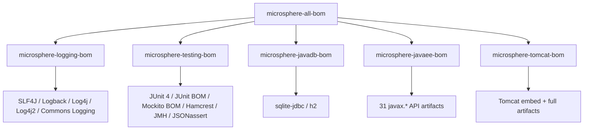

# microsphere-all-bom — User Guide

> Part of the [Microsphere BOM User Guide](README.md) · [中文文档](zh/all-bom.md)

## Overview

`microsphere-all-bom` is the **aggregator BOM**: a single import that pulls in all five domain BOMs. For most
Microsphere projects it is the only `<dependencyManagement>` entry you need.



## Maven Coordinates

| Field | Value |
|-------|-------|
| groupId | `io.github.microsphere-projects` |
| artifactId | `microsphere-all-bom` |
| version | `0.3.16` (release line `0.3.x`) |
| packaging | `pom` (BOM) |

## API Explanation

- The module declares **no version properties of its own**; every managed version comes from the imported domain
  BOMs. Its own POM contains exactly five entries, each `<type>pom</type><scope>import</scope>`.
- Import order in `microsphere-all-bom` is: logging → testing → javadb → javaee → tomcat. Because Maven applies
  **"first declaration wins"** across imports, if two domain BOMs ever managed the same coordinate, the earlier
  one would take precedence. (Today there are no overlaps.)
- All JDK-activated profile behavior of the domain BOMs carries over transitively — see each module doc
  ([logging](logging-bom.md), [testing](testing-bom.md), [javadb](javadb-bom.md), [tomcat](tomcat-bom.md)).

## Managed Dependencies

The union of all domain BOMs; consult the per-module pages for the full tables:

| Domain BOM | Managed Scope |
|------------|---------------|
| [microsphere-logging-bom](logging-bom.md) | 8 logging artifacts |
| [microsphere-testing-bom](testing-bom.md) | 5 direct artifacts + full `junit-bom` and `mockito-bom` families |
| [microsphere-javadb-bom](javadb-bom.md) | 2 JDBC drivers |
| [microsphere-javaee-bom](javaee-bom.md) | 31 `javax.*` API artifacts |
| [microsphere-tomcat-bom](tomcat-bom.md) | 25 Tomcat artifacts (+1 under `java17+`) |

## Code Examples

This is the exact usage pattern of `microsphere-bom-example`, the repository's own validation module:

```xml
<dependencyManagement>
    <dependencies>
        <dependency>
            <groupId>io.github.microsphere-projects</groupId>
            <artifactId>microsphere-all-bom</artifactId>
            <version>0.3.16</version>
            <type>pom</type>
            <scope>import</scope>
        </dependency>
    </dependencies>
</dependencyManagement>

<dependencies>
    <!-- every one of these resolves its version from a different domain BOM -->
    <dependency>
        <groupId>org.slf4j</groupId>
        <artifactId>slf4j-api</artifactId>
    </dependency>
    <dependency>
        <groupId>org.junit.jupiter</groupId>
        <artifactId>junit-jupiter</artifactId>
        <scope>test</scope>
    </dependency>
    <dependency>
        <groupId>com.h2database</groupId>
        <artifactId>h2</artifactId>
        <scope>test</scope>
    </dependency>
    <dependency>
        <groupId>javax.servlet</groupId>
        <artifactId>javax.servlet-api</artifactId>
        <scope>provided</scope>
    </dependency>
    <dependency>
        <groupId>org.apache.tomcat.embed</groupId>
        <artifactId>tomcat-embed-core</artifactId>
    </dependency>
</dependencies>
```

Verify what the BOM resolves in your project:

```bash
mvn dependency:tree            # effective versions of every dependency
mvn help:effective-pom         # the merged dependencyManagement
```

## Version Information & Compatibility

- **BOM version**: release line `0.3.x` (latest **0.3.16**). All five domain BOMs share the same version —
  they are released together from one reactor, so never mix `microsphere-*-bom` versions from different releases.
- **JDK compatibility**: inherits the union of domain rules; the binding constraints on the default (JDK 17+)
  resolution are JUnit 6 (needs 17+), Tomcat 11 (needs 17+) and Logback 1.6 (needs 11+). On JDK 8 all three fall
  back automatically (JUnit 5.14.4 / Mockito 4.11.0, Tomcat 9.0.120, Logback 1.3.16).
  Full matrix: [versions.md](versions.md).

## See Also

- Developer analysis: [../../developer-guide/architecture.md](../developer-guide/architecture.md)
- Versions overview: [versions.md](versions.md)
