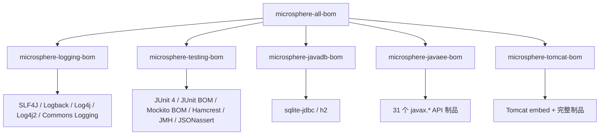

# microsphere-all-bom — 用户文档

> 本文属于 [Microsphere BOM 用户文档](README.md) · 英文版见 [../all-bom.md](../all-bom.md)

## 概述

`microsphere-all-bom` 是**聚合 BOM**：一次导入即获得全部五个领域 BOM。对多数 Microsphere 项目而言，它是
`<dependencyManagement>` 中唯一需要的条目。



## Maven 坐标

| 字段 | 值 |
|------|-----|
| groupId | `io.github.microsphere-projects` |
| artifactId | `microsphere-all-bom` |
| version | `0.3.16`（release 版本线 `0.3.x`） |
| packaging | `pom`（BOM） |

## API 解释

- 该模块**不声明自己的版本属性**，所有托管版本来自被导入的领域 BOM；其 POM 中恰好只有五个条目，全部为
  `<type>pom</type><scope>import</scope>`。
- `microsphere-all-bom` 中的导入顺序为：logging → testing → javadb → javaee → tomcat。Maven 在多个 import 之间
  应用**"先声明者优先"**，因此若两个领域 BOM 将来托管同一坐标，靠前者生效（目前无重叠）。
- 各领域 BOM 的 JDK profile 行为可传递地保留 —— 见各模块文档
  （[logging](logging-bom.md)、[testing](testing-bom.md)、[javadb](javadb-bom.md)、[tomcat](tomcat-bom.md)）。

## 托管依赖清单

为五个领域 BOM 的并集，完整表格见各模块页面：

| 领域 BOM | 托管范围 |
|-----------|----------|
| [microsphere-logging-bom](logging-bom.md) | 8 个日志制品 |
| [microsphere-testing-bom](testing-bom.md) | 5 个直接制品 + 完整的 `junit-bom`、`mockito-bom` 制品族 |
| [microsphere-javadb-bom](javadb-bom.md) | 2 个 JDBC 驱动 |
| [microsphere-javaee-bom](javaee-bom.md) | 31 个 `javax.*` API 制品 |
| [microsphere-tomcat-bom](tomcat-bom.md) | 25 个 Tomcat 制品（`java17+` 下再加 1 个） |

## 代码示例

以下就是本仓库校验模块 `microsphere-bom-example` 的准确用法：

```xml
<dependencyManagement>
    <dependencies>
        <dependency>
            <groupId>io.github.microsphere-projects</groupId>
            <artifactId>microsphere-all-bom</artifactId>
            <version>0.3.16</version>
            <type>pom</type>
            <scope>import</scope>
        </dependency>
    </dependencies>
</dependencyManagement>

<dependencies>
    <!-- 以下每个依赖的版本分别来自不同的领域 BOM -->
    <dependency>
        <groupId>org.slf4j</groupId>
        <artifactId>slf4j-api</artifactId>
    </dependency>
    <dependency>
        <groupId>org.junit.jupiter</groupId>
        <artifactId>junit-jupiter</artifactId>
        <scope>test</scope>
    </dependency>
    <dependency>
        <groupId>com.h2database</groupId>
        <artifactId>h2</artifactId>
        <scope>test</scope>
    </dependency>
    <dependency>
        <groupId>javax.servlet</groupId>
        <artifactId>javax.servlet-api</artifactId>
        <scope>provided</scope>
    </dependency>
    <dependency>
        <groupId>org.apache.tomcat.embed</groupId>
        <artifactId>tomcat-embed-core</artifactId>
    </dependency>
</dependencies>
```

在项目里验证 BOM 实际解析结果：

```bash
mvn dependency:tree            # 每个依赖的有效版本
mvn help:effective-pom         # 合并后的 dependencyManagement
```

## 版本信息与兼容性

- **BOM 版本**：版本线 `0.3.x`（最新 **0.3.16**）。五个领域 BOM 版本完全一致 —— 它们在同一 reactor 中一起发布，
  切勿混用不同发布版本的 `microsphere-*-bom`。
- **JDK 兼容性**：继承各领域规则的并集。默认（JDK 17+）解析下的约束项为 JUnit 6（需 17+）、Tomcat 11（需 17+）
  与 Logback 1.6（需 11+）。在 JDK 8 上三者自动回退（JUnit 5.14.4 / Mockito 4.11.0、Tomcat 9.0.120、
  Logback 1.3.16）。完整矩阵见 [versions.md](versions.md)。

## 相关文档

- 开发者源码分析：[../../developer-guide/zh/architecture.md](../../developer-guide/zh/architecture.md)
- 版本总览：[versions.md](versions.md)
